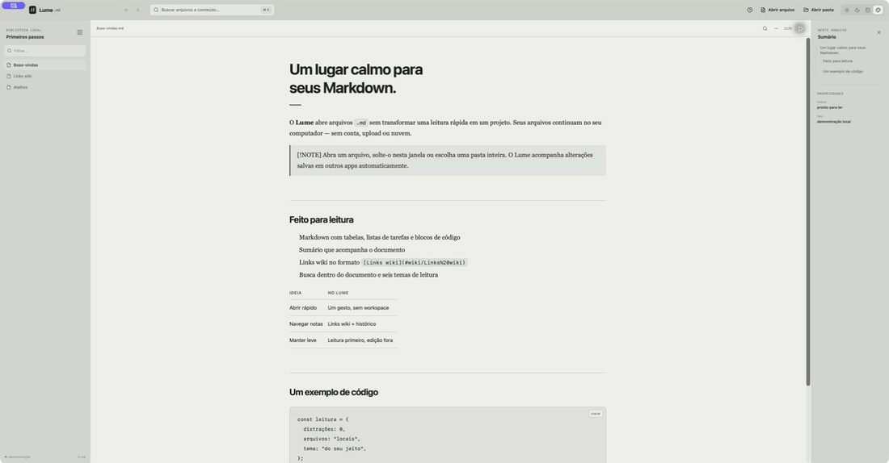
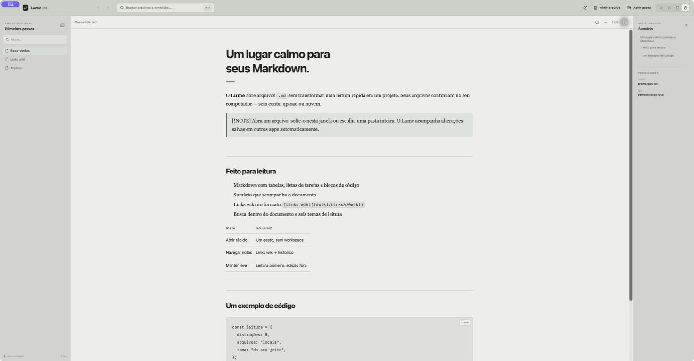
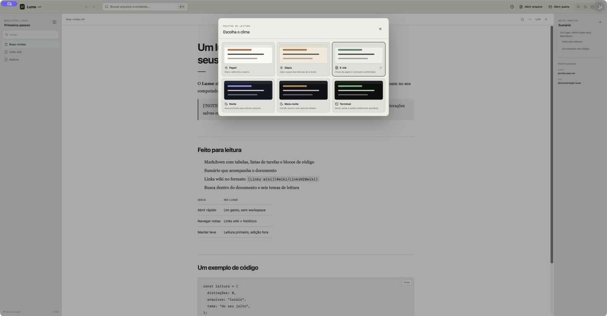
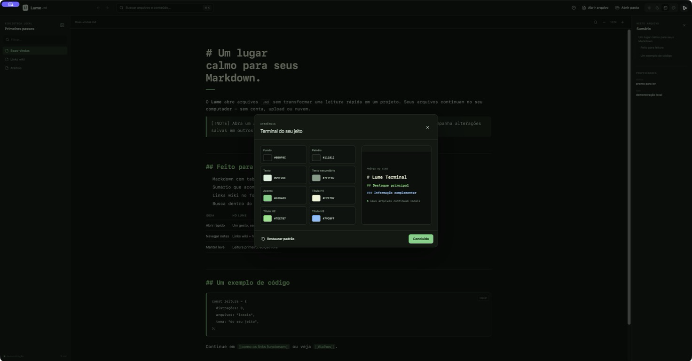

<p align="center">
  
</p>

<h1 align="center">Lume</h1>

<p align="center">
  <strong>Markdown, só para ler.</strong><br>
  Um leitor local, bonito e independente para macOS — sem editor, conta ou workspace.
</p>

<p align="center">
  <a href="https://github.com/salo-adm-camelie/lume-markdown-reader/releases/latest"></a>
  
  
  <a href="LICENSE"></a>
</p>



## Por que o Lume?

O Lume abre arquivos Markdown para leitura sem transformar uma consulta rápida
em um projeto de edição. Ele acompanha pastas, entende links wiki e mantém tudo
no seu computador.

- abre arquivos `.md`, `.markdown` e `.mdown`, avulsos ou em pastas
- busca por nome e conteúdo, com trechos dos resultados
- busca no documento atual com destaques e navegação entre ocorrências
- navega por `[[Nota]]`, `[[Nota|apelido]]`, `[[Nota#Seção]]` e links relativos
- monta sumário e propriedades a partir do conteúdo e do YAML front matter
- lembra documentos recentes somente neste dispositivo
- acompanha alterações salvas por outros aplicativos
- oferece seis temas, zoom, impressão/PDF e modo Terminal personalizável
- funciona offline e não envia seus arquivos a nenhum servidor

## Três jeitos de ler

### Papel — leitura ampla e sem distrações



### Seis paletas prontas



### Terminal — cores totalmente ajustáveis



## Instalação no macOS

1. Baixe o `.dmg` na página de
   [Releases](https://github.com/salo-adm-camelie/lume-markdown-reader/releases/latest).
2. Abra a imagem e arraste **Lume** para **Aplicativos**.
3. Abra qualquer Markdown pelo Lume ou escolha uma pasta dentro do app.

O fluxo de release gera um binário universal para Intel e Apple Silicon,
assinado com Developer ID e notarizado pela Apple. O requisito mínimo é macOS
12 Monterey.

## Atalhos

| Ação | Atalho |
| --- | --- |
| Buscar arquivos e conteúdo | `⌘ K` |
| Buscar no documento | `⌘ F` |
| Fechar busca ou janela auxiliar | `Esc` |
| Próxima ocorrência | `Enter` |
| Ocorrência anterior | `⇧ Enter` |

## Desenvolvimento

Requisitos: Node.js 22+, Rust e as ferramentas de linha de comando do Xcode.

```bash
npm install
npm run desktop
```

Verificações locais:

```bash
npm test
npm run typecheck:desktop
npm run lint
cargo test --manifest-path src-tauri/Cargo.toml
```

Para gerar um app universal local com assinatura ad hoc:

```bash
rustup target add aarch64-apple-darwin x86_64-apple-darwin
APPLE_SIGNING_IDENTITY=- npm run desktop:build -- --target universal-apple-darwin
```

O workflow de release usa os segredos Apple descritos no guia oficial do
[Tauri](https://v2.tauri.app/distribute/sign/macos/) para assinar, notarizar,
grampear o ticket da Apple e publicar o DMG no GitHub.

O passo a passo de manutenção está em [docs/RELEASING.md](docs/RELEASING.md).

## Privacidade

O conteúdo é processado localmente pelo WebView do macOS. O Lume não exige
conta, não inclui telemetria e não envia documentos para uma nuvem.

## Licença

O Lume é distribuído sob a [licença MIT](LICENSE). Bibliotecas, fontes e
ferramentas de terceiros conservam suas próprias licenças; veja
[THIRD_PARTY_NOTICES.md](THIRD_PARTY_NOTICES.md).
